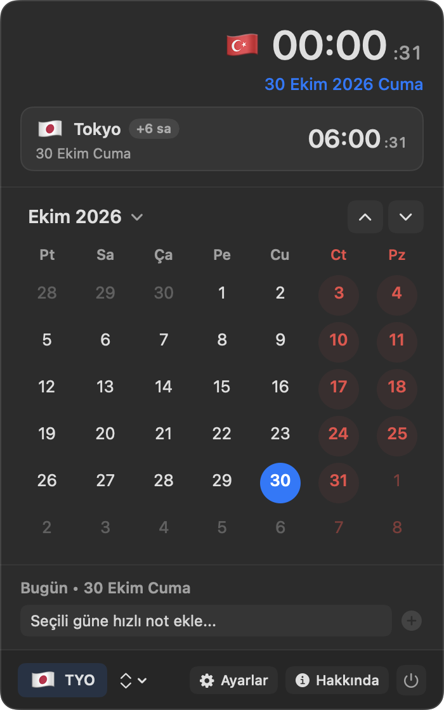

# MacCalendar — macOS Menü Çubuğu Takvim & Çift Dünya Saati
### Native macOS Menu Bar Calendar & Dual World Clock

<p align="center">
  
  &nbsp;&nbsp;
  
  &nbsp;&nbsp;
  
</p>

<p align="center">
  <a href="#türkçe"><b>🇹🇷 Türkçe</b></a> &nbsp;•&nbsp; <a href="#english"><b>🇬🇧 English</b></a>
</p>

---

<a name="türkçe"></a>
## 🇹🇷 Türkçe Tanıtım

**MacCalendar**, macOS menü çubuğunda (Menu Bar) hafif ve zarif bir şekilde çalışan, tek bir tıklamayla açılan modern takvim penceresi sunan, ülke bayraklarıyla birlikte aynı anda **iki farklı dünya saatini** (örneğin `🇹🇷 20:04   🇯🇵 02:04`) gösterebilen yerel (native) bir macOS uygulamasıdır.

Tamamen **Swift**, **AppKit** ve **SwiftUI** teknolojileri kullanılarak macOS ekosistemine tam uyumlu ve yüksek performanslı olarak geliştirilmiştir.

---

### ✨ Öne Çıkan Özellikler

#### 1. Menü Çubuğu (Menu Bar) Görünümü
- **Dinamik Gün Simgesi:** Menü çubuğunda o günün takvim gün numarasını içeren özel tasarlanmış mini simge.
- **Canlı Tarih & Saat Formatları:** İsteğe bağlı olarak tarih (`29 Eki Per`, `29.10.2026`, `29 Ekim` veya sadece saat), saniyeli gösterim ve özelleştirilebilir bayrak rozetleri.
- **Çift Saat Gösterimi (Açılıp Kapatılabilir):**
  - Tek tıkla sadece yerel saati (`🇹🇷 20:04`) veya yerel saatle birlikte seçilen dünya şehrinin saatini (`🇹🇷 20:04   🇯🇵 02:04`) menü çubuğunda yan yana gösterebilme.
  - 5 farklı bayrak ve saat dizilim seçeneği (bayrak başta, bayrak sonda, bayraklar ortada, sadece 2. bayrak veya bayrak + şehir kodu).

#### 2. Açılır Takvim Penceresi (Flyout Panel)
- **Akıllı Başlık Alanı:**
  - Yerel ülke bayrağı, canlı saniyeli büyük dijital saat ve tam gün adı formatlı tarih.
  - İkinci saat aktif olduğunda, hedef ülkenin bayrağı, şehir adı, saat farkı rozeti (örn. `+6 sa`) ve canlı ikinci saat kartı.
- **Aylık Takvim Izgarası:**
  - Cumartesi ve Pazar günleri için belirgin hafta sonu renklendirmesi.
  - Önceki ve sonraki aydan taşan soluk günler, bugünün mavi dolgulu dairesi ve seçili gün vurgusu.
  - **"Bugün"** butonu: Farklı bir aya veya yıla gidildiğinde tek tıkla bugünkü tarihe geri dönme imkânı.
  - Hızlı Ay/Yıl Seçici: Ay başlığına tıklayarak yıl ve ay listesinden anında seçim yapabilme.
  - Haftanın başlangıç gününü (Pazartesi veya Pazar) seçebilme.

#### 3. Güne Özel Hızlı Not & Hatırlatıcılar
- Takvimdeki herhangi bir güne tıklayarak anında hızlı not ekleyebilme.
- Not içeren günler takvim ızgarasında özel bir nokta işareti ile gösterilir.
- Eklenen notları kolayca silebilme ve gün bazlı listeleme.

#### 4. 400+ Dünya Şehri ve Saat Dilimi Arama
- Ön tanımlı popüler metropoller (Tokyo, Londra, New York, Berlin, Paris, Seul, Dubai, Singapur, Los Angeles, Pekin, Sidney, Bakü vb.).
- Entegre **400+ şehir arama motoru** sayesinde dünyanın dört bir yanındaki herhangi bir şehri veya saat dilimini saniyeler içinde bulup ikinci saat olarak atayabilme.
- Özel etiket alanı (örn. `TYO`, `Ofis`, `Ev` vb.).

#### 5. Canlı ve Reaktif Çoklu Dil Desteği
- Uygulama içindeki Ayarlar bölümünden anında **Türkçe**, **English** veya **Sistem Dili** seçebilme.
- Uygulamayı kapatıp açmaya gerek kalmadan tüm arayüz, menü çubuğu formatları, ay ve gün isimleri anında seçilen dile güncellenir.

#### 6. macOS Başlangıcında Otomatik Çalışma & Güvenli Çıkış
- **Otomatik Başlatma:** macOS `ServiceManagement` (`SMAppService`) desteği sayesinde bilgisayarınız her açıldığında arka planda otomatik olarak başlama seçeneği.
- **Güvenli Çıkış Onayı:** Refleks olarak yanlışlıkla güç butonuna basılması durumunda uygulamayı anında kapatmak yerine yerleşik şık bir onay alanı açarak veri ve durum kaybını önler.

---

### 🚀 Kurulum ve Çalıştırma

#### Hazır Uygulama Paketini Başlatma:
```bash
open MacCalendar.app
```

#### Kaynak Koddan Derleme:
```bash
./build_app.sh
```

### 📄 Lisans & Depo

- **Geliştirici:** Rafet Sapancı
- **GitLab Deposu:** [gitlab.com/freeware2/maccalendar](https://gitlab.com/freeware2/maccalendar)
- **Teknolojiler:** Native Swift, AppKit & SwiftUI (macOS 13+)

---

<a name="english"></a>
## 🇬🇧 English Description

**MacCalendar** is a lightweight, elegant native macOS menu bar application designed to provide a modern floating calendar flyout and simultaneously display **dual world clocks** with country flag badges (e.g., `🇹🇷 20:04   🇯🇵 02:04`) right in your menu bar.

Built natively using **Swift**, **AppKit**, and **SwiftUI**, it offers top-tier performance, minimal resource usage, and a seamless macOS experience.

---

### ✨ Key Features

#### 1. Menu Bar Display
- **Dynamic Calendar Day Badge:** Displays a customized mini calendar icon showing today's day number in the menu bar.
- **Customizable Date & Clock Formats:** Choose your preferred date style (`29 Oct Thu`, `29.10.2026`, `29 October`, or Time Only), optional seconds display, and flag badges.
- **Dual Clock Mode (Toggleable):**
  - Switch between local time only (`🇹🇷 20:04`) and dual world clock mode (`🇹🇷 20:04   🇯🇵 02:04`) with a single click.
  - 5 customizable flag layout styles (flags preceding time, flags trailing time, flags in the middle, second flag only, or flag with city code).

#### 2. Floating Calendar Flyout
- **Header Card:**
  - Local country flag automatically resolved from your system time zone/region, large live digital clock with seconds, and full localized date string.
  - Dedicated secondary clock card showing the target country flag, city name, time difference badge (e.g., `+6 hrs`), and live secondary time.
- **Monthly Calendar Grid:**
  - Distinct weekend coloring for Saturday and Sunday.
  - Leading and trailing out-of-month days, highlighted current day badge, and day selection indicator.
  - **"Today" Quick Jump:** Instantly returns to the current day from any month or year.
  - Interactive Month/Year Picker: Click on the header to easily navigate across different years and months.
  - Configurable week start day (Monday or Sunday).

#### 3. Daily Quick Notes & Reminders
- Click on any calendar day to attach quick notes or reminders.
- Days with notes are visually marked with an indicator dot on the calendar grid.
- Easily review and delete notes per date.

#### 4. 400+ World Cities & Time Zones Search
- Pre-configured presets for major global hubs (Tokyo, London, New York, Berlin, Paris, Seoul, Dubai, Singapore, Los Angeles, Beijing, Sydney, Baku, etc.).
- Integrated **search across 400+ world cities** to find and track any global time zone instantly.
- Optional custom label field (e.g., `TYO`, `Office`, `HQ`).

#### 5. Live & Reactive Multi-Language Support
- Switch seamlessly between **English**, **Türkçe**, or **System Language** directly from the Preferences panel.
- No application restart required: all UI labels, menu bar formats, weekday headers, and months update immediately upon selection.

#### 6. Launch Automatically at Login & Safe Quit
- **Auto Launch:** Native macOS `ServiceManagement` (`SMAppService`) integration allowing MacCalendar to start automatically whenever your Mac boots up.
- **Accidental Quit Protection:** Prompt an inline confirmation dialog when clicking the power button to prevent accidental termination.

---

### 🚀 Build & Run

#### Run the App:
```bash
open MacCalendar.app
```

#### Compile from Source:
```bash
./build_app.sh
```

---

### 📄 License & Repository

- **Developer:** Rafet Sapancı
- **GitLab Repository:** [gitlab.com/freeware2/maccalendar](https://gitlab.com/freeware2/maccalendar)
- **Tech Stack:** Native Swift, AppKit & SwiftUI (macOS 13+)
