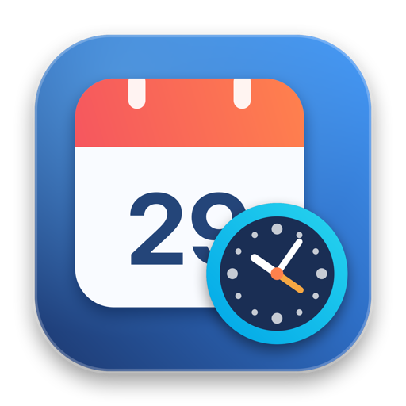
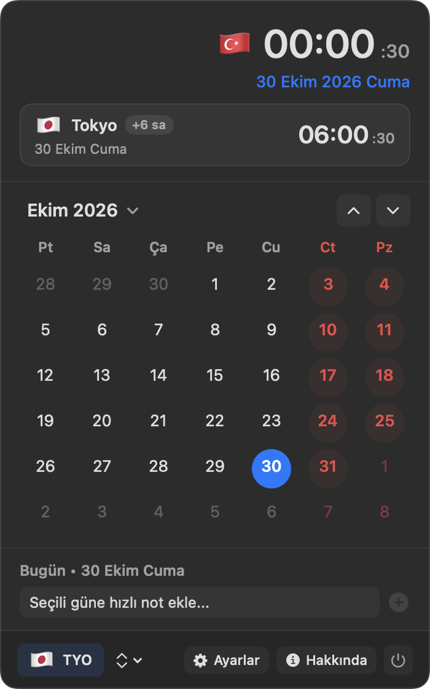
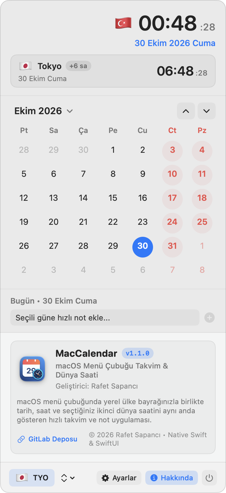

<p align="center">
  
</p>

<h1 align="center">MacCalendar</h1>

<p align="center">
  A native <b>menu bar calendar</b> for macOS with a <b>dual world clock</b> and country flags (<code>🇹🇷 20:04   🇯🇵 02:04</code>).<br>
  Written in Swift with AppKit and SwiftUI; no Electron and no third-party libraries.
</p>

<p align="center">
  <b>🇬🇧 English</b> · <a href="README.tr.md">🇹🇷 Türkçe</a>
</p>

<p align="center">
  <a href="https://gitlab.com/freeware2/maccalendar/-/releases/permalink/latest/downloads/MacCalendar.zip"></a>
</p>

<p align="center">
  <a href="https://gitlab.com/freeware2/maccalendar/-/releases">All releases</a> · <a href="#download-and-install">Installation steps</a> · The interface is in English and Turkish
</p>

> [!warning] The first time you open MacCalendar, macOS blocks it. This is expected.
> MacCalendar is free and not notarized by Apple, so the first time you open it macOS says it *could not verify* the app and does not open it. You only need to allow it once:
>
> 1. In the warning, click **Done**. Do **not** click *Move to Trash*.
> 2. Open **System Settings ▸ Privacy & Security** and scroll down to **Security**.
> 3. On the line saying MacCalendar was blocked, click **Open Anyway** and confirm with your password or Touch ID.
>
> Prefer Terminal? Run `xattr -dr com.apple.quarantine /Applications/MacCalendar.app`, then open MacCalendar.

## Screenshots

The calendar flyout with the second clock (Tokyo), and the About panel.

<p align="center">
  
  &nbsp;
  
</p>

## Features

### Menu bar

- **Day badge:** a small calendar icon with today's day number.
- **Date and time formats:** `30 Oct Fri`, `30.10.2026`, `30 October` or time only, with optional seconds and flag badges.
- **Dual clock (on or off):** show only the local time (`🇹🇷 20:04`) or the local time next to a second city (`🇹🇷 20:04   🇯🇵 02:04`).
  Five layouts: flags before the time, after the time, in the middle, second flag only, or flag with a city code.

### Calendar flyout

- **Header:** your country's flag (from the system time zone and region), a large live clock with seconds and the full date.
  With the second clock on, a card shows the other city's flag, name, time difference (e.g. `+6 hrs`) and live time.
- **Month grid:** weekends in color, days of the previous and next month dimmed, today and the selected day highlighted.
- **Today** button to jump back from any month or year; click the month title to pick a month and year.
- Week starts on Monday or Sunday, as you choose.

### Quick notes for a day

- Click any day to add a short note or reminder.
- Days with notes get a dot on the grid; notes are listed and deleted per day.

### 400+ world cities and time zones

- Presets for major cities (Tokyo, London, New York, Berlin, Paris, Seoul, Dubai, Singapore, Los Angeles, Beijing, Sydney, Baku and more).
- Search more than 400 cities to use any time zone as the second clock, with an optional custom label (`TYO`, `Office`, `HQ`).

### Language, login and quit

- **English, Turkish or the system language**, switched in Settings without restarting: labels, menu bar formats, month and weekday names change at once.
- **Launch at login** through macOS `ServiceManagement` (`SMAppService`).
- **Quit confirmation:** the power button asks first, so a stray click does not close the app.

## Download and install

The package runs on Apple Silicon and Intel Macs; macOS 13 or later is required.

1. Download the latest version with the [download button](https://gitlab.com/freeware2/maccalendar/-/releases/permalink/latest/downloads/MacCalendar.zip) at the top, or pick a version on the [Releases](https://gitlab.com/freeware2/maccalendar/-/releases) page.
2. Open the zip. Safari usually opens it by itself and a `MacCalendar-<version>` folder appears in Downloads; if not, double-click the zip.
3. Drag `MacCalendar.app` from that folder to **Applications**. The `LICENSE.txt` next to it is the license text; it does not need to be installed.
4. Open MacCalendar. Its icon appears in the menu bar, not in the Dock. **The first time, macOS blocks it:** follow the steps below once.

### First launch: allow MacCalendar once

> [!important] macOS blocks MacCalendar the first time you open it. This is expected, not a fault.
> MacCalendar is not signed with an Apple developer ID and is not notarized by Apple, so macOS cannot verify it. Allow it once and it opens normally from then on:
>
> 1. **Double-click MacCalendar.** macOS says Apple could not verify it and does not open it. Click **Done**. Do **not** click *Move to Trash*.
> 2. **Open System Settings ▸ Privacy & Security** and scroll down to the **Security** section.
> 3. **Click Open Anyway** on the line saying MacCalendar was blocked, then confirm with your Mac password or Touch ID. If macOS asks once more, choose **Open Anyway** again.
>
> Don't see *Open Anyway*? Repeat step 1: the button only appears after an attempt to open the app. On macOS 13 and 14 you can also right-click MacCalendar in the Finder and choose **Open**.

> [!tip] Using Terminal? One command does the same.
> ```bash
> xattr -dr com.apple.quarantine /Applications/MacCalendar.app
> ```
> It removes the quarantine flag macOS puts on files downloaded from the internet. MacCalendar then opens with a double-click as usual.

### Verifying the download

Compare the zip with the SHA-256 value in the release notes:

```bash
shasum -a 256 ~/Downloads/MacCalendar-1.1.0.zip
```

## Building from source

Requires the Xcode command line tools (macOS 13 or later).

```bash
./build_app.sh          # builds MacCalendar.app (universal: arm64 + x86_64)
./build_app.sh --zip    # also build/release/MacCalendar-<version>.zip and its SHA-256
```

## License

Copyright © 2026 Rafet SAPANCI

MacCalendar is free software: you can use, change and redistribute it under the [GNU General Public License](LICENSE), version 3 or (at your option) any later version (GPL-3.0-or-later). If you distribute changed versions, you must offer their source code under the same license. The program comes with **no warranty**; see [LICENSE](LICENSE) for details.
