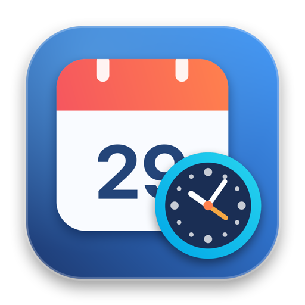
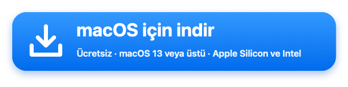
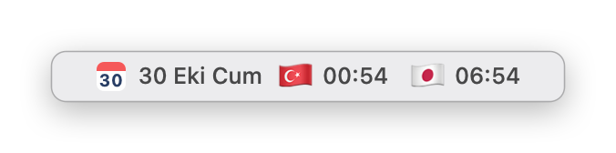
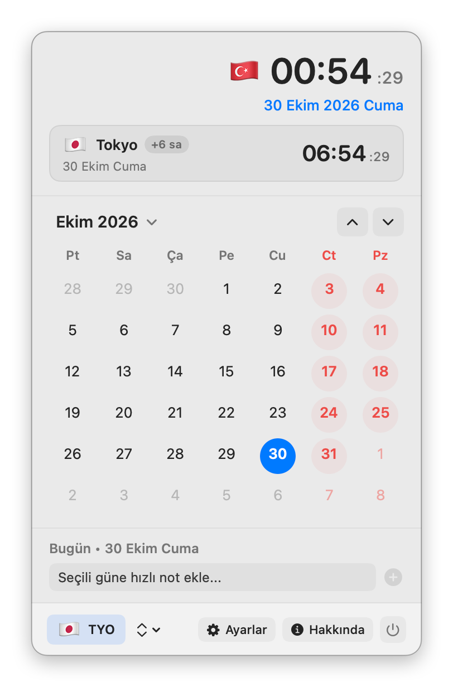
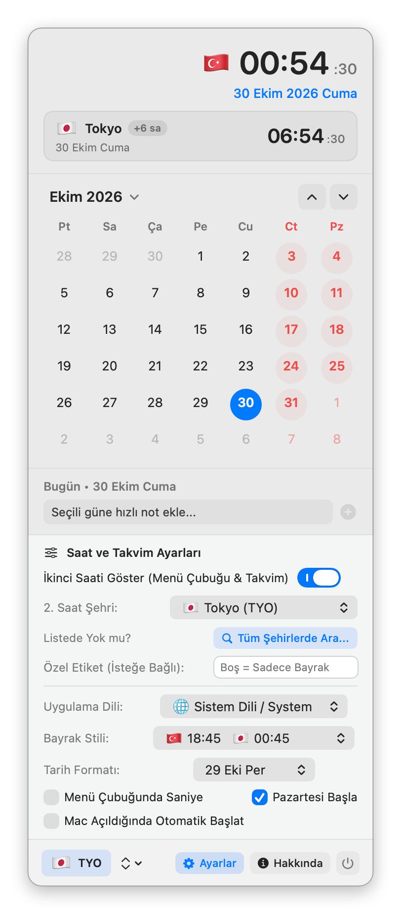

<p align="center">
  
</p>

<h1 align="center">MacCalendar</h1>

<p align="center">
  macOS için ülke bayraklı <b>çift dünya saati</b> gösteren (<code>🇹🇷 20:04   🇯🇵 02:04</code>), yerel bir <b>menü çubuğu takvimi</b>.<br>
  Swift, AppKit ve SwiftUI ile yazılmıştır; Electron ya da üçüncü taraf kütüphane gerektirmez.
</p>

<p align="center">
  <a href="README.md">🇬🇧 English</a> · <b>🇹🇷 Türkçe</b>
</p>

<p align="center">
  <a href="https://gitlab.com/freeware2/maccalendar/-/releases/permalink/latest/downloads/MacCalendar.zip"></a>
</p>

<p align="center">
  <a href="https://gitlab.com/freeware2/maccalendar/-/releases">Tüm sürümler</a> · <a href="#kurulum">Kurulum adımları</a> · Arayüz Türkçe ve İngilizcedir
</p>

> [!warning] MacCalendar'ı ilk açtığınızda macOS onu engeller. Bu beklenen bir durumdur.
> MacCalendar ücretsizdir ve Apple onayından (notarization) geçmemiştir. Bu yüzden ilk açılışta macOS uygulamayı *doğrulayamadığını* söyler ve açmaz. Bunu bir kez onaylamanız yeterlidir:
>
> 1. Uyarıda **Bitti**'ye tıklayın. *Çöp Sepetine Taşı*'yı **seçmeyin**.
> 2. **Sistem Ayarları ▸ Gizlilik ve Güvenlik**'i açın ve **Güvenlik** bölümüne inin.
> 3. MacCalendar'ın engellendiğini belirten satırda **Yine de Aç**'a tıklayın ve parolanız ya da Touch ID ile onaylayın.
>
> Terminal'i mi tercih edersiniz? `xattr -dr com.apple.quarantine /Applications/MacCalendar.app` komutunu çalıştırıp MacCalendar'ı açın.

## Ekran görüntüleri

Menü çubuğunda tarih ve iki saat, tıklayınca açılan takvim ve Ayarlar paneli açıkken aynı pencere.

<p align="center"></p>

<p align="center">
  
  &nbsp;
  
</p>

## Özellikler

### Menü çubuğu

- **Gün simgesi:** o günün tarihini gösteren küçük takvim simgesi.
- **Tarih ve saat biçimleri:** `30 Eki Cum`, `30.10.2026`, `30 Ekim` ya da yalnızca saat; isteğe bağlı saniye ve bayrak rozetleri.
- **Çift saat (açılıp kapatılabilir):** yalnızca yerel saati (`🇹🇷 20:04`) ya da yanında ikinci bir şehrin saatini (`🇹🇷 20:04   🇯🇵 02:04`) gösterin.
  Beş dizilim: bayrak saatten önce, saatten sonra, ortada, yalnızca ikinci bayrak ya da bayrak ve şehir kodu.

### Takvim penceresi

- **Başlık:** ülkenizin bayrağı (sistem saat dilimi ve bölgesinden), saniyeli büyük canlı saat ve tam tarih.
  İkinci saat açıkken bir kart diğer şehrin bayrağını, adını, saat farkını (örn. `+6 sa`) ve canlı saatini gösterir.
- **Aylık takvim:** hafta sonları renkli, önceki ve sonraki ayın günleri soluk, bugün ve seçili gün vurgulu.
- Herhangi bir ay ya da yıldan tek tıkla dönmek için **Bugün** düğmesi; ay başlığına tıklayarak ay ve yıl seçimi.
- Hafta Pazartesi ya da Pazar başlar; seçim sizin.

### Güne özel hızlı notlar

- Herhangi bir güne tıklayıp kısa bir not ya da hatırlatma ekleyin.
- Not içeren günler takvimde bir noktayla işaretlenir; notlar gün gün listelenir ve silinir.

### 400+ dünya şehri ve saat dilimi

- Büyük şehirler hazır gelir (Tokyo, Londra, New York, Berlin, Paris, Seul, Dubai, Singapur, Los Angeles, Pekin, Sidney, Bakü ve diğerleri).
- 400'den fazla şehir arasında arama yapıp istediğiniz saat dilimini ikinci saat yapın; isterseniz özel bir etiket verin (`TYO`, `Ofis`, `Ev`).

### Dil, oturum açılışı ve çıkış

- **Türkçe, İngilizce ya da sistem dili**; Ayarlar'dan, yeniden başlatmadan değişir: etiketler, menü çubuğu biçimleri, ay ve gün adları anında güncellenir.
- macOS `ServiceManagement` (`SMAppService`) ile **oturum açılışında başlatma**.
- **Çıkış onayı:** güç düğmesi önce sorar; yanlışlıkla tıklamak uygulamayı kapatmaz.

<a name="kurulum"></a>
## İndirme ve kurulum

Paket Apple Silicon ve Intel Mac'lerde çalışır; macOS 13 veya üstü gerekir.

1. En son sürümü yukarıdaki [indirme düğmesiyle](https://gitlab.com/freeware2/maccalendar/-/releases/permalink/latest/downloads/MacCalendar.zip) indirin ya da [Sürümler](https://gitlab.com/freeware2/maccalendar/-/releases) sayfasından bir sürüm seçin.
2. Zip'i açın. Safari genellikle kendiliğinden açar ve İndirilenler'de `MacCalendar-<sürüm>` klasörü belirir; açmazsa zip'e çift tıklayın.
3. O klasördeki `MacCalendar.app`'i **Uygulamalar** klasörüne sürükleyin. Yanındaki `LICENSE.txt` lisans metnidir; kurulması gerekmez.
4. MacCalendar'ı açın. Simgesi Dock'ta değil, menü çubuğunda görünür. **İlk açılışta macOS onu engeller:** aşağıdaki adımları bir kez izleyin.

### İlk açılış: MacCalendar'a bir kez izin verin

> [!important] macOS, MacCalendar'ı ilk açılışta engeller. Bu bir hata değil, beklenen bir durumdur.
> MacCalendar bir Apple geliştirici kimliğiyle imzalanmamış ve Apple onayından geçmemiştir; bu yüzden macOS onu doğrulayamaz. Bir kez izin verin, sonrasında normal açılır:
>
> 1. **MacCalendar'a çift tıklayın.** macOS, Apple'ın onu doğrulayamadığını söyler ve açmaz. **Bitti**'ye tıklayın. *Çöp Sepetine Taşı*'yı **seçmeyin**.
> 2. **Sistem Ayarları ▸ Gizlilik ve Güvenlik**'i açın ve **Güvenlik** bölümüne inin.
> 3. MacCalendar'ın engellendiğini belirten satırda **Yine de Aç**'a tıklayın, ardından Mac parolanız ya da Touch ID ile onaylayın. macOS bir kez daha sorarsa yine **Yine de Aç**'ı seçin.
>
> *Yine de Aç* görünmüyor mu? 1. adımı tekrarlayın: düğme ancak uygulamayı açma denemesinden sonra çıkar. macOS 13 ve 14'te Finder'da MacCalendar'a sağ tıklayıp **Aç**'ı da seçebilirsiniz.

> [!tip] Terminal mi kullanıyorsunuz? Tek komut aynı işi yapar.
> ```bash
> xattr -dr com.apple.quarantine /Applications/MacCalendar.app
> ```
> macOS'un internetten indirilen dosyalara koyduğu karantina işaretini kaldırır. Sonrasında MacCalendar her zamanki gibi çift tıklamayla açılır.

### İndirilen dosyayı doğrulama

Zip'i sürüm notlarındaki SHA-256 değeriyle karşılaştırın:

```bash
shasum -a 256 ~/Downloads/MacCalendar-1.1.1.zip
```

## Kaynak koddan derleme

Xcode komut satırı araçları gerekir (macOS 13 veya üstü).

```bash
./build_app.sh          # MacCalendar.app'i derler (universal: arm64 + x86_64)
./build_app.sh --zip    # ayrıca build/release/MacCalendar-<sürüm>.zip ve SHA-256
```

## Lisans

Telif hakkı © 2026 Rafet SAPANCI

MacCalendar özgür yazılımdır: [GNU Genel Kamu Lisansı](LICENSE) sürüm 3 ya da (tercihinize göre) daha sonraki bir sürüm (GPL-3.0-or-later) koşullarıyla kullanabilir, değiştirebilir ve yeniden dağıtabilirsiniz. Değiştirilmiş sürümleri dağıtırsanız kaynak kodlarını da aynı lisansla sunmalısınız. Program **hiçbir garanti olmadan** sunulur; ayrıntılar için [LICENSE](LICENSE) dosyasına bakın.
